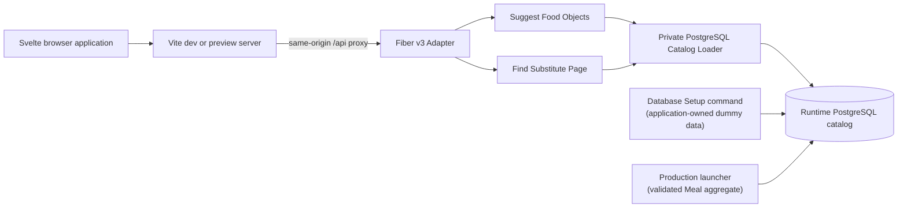

# Obiad Architecture

This document is the source of truth for the current Obiad proof-of-concept architecture. It implements the active requirements in [requirements/requirements.md](requirements/requirements.md).

## System overview

Obiad runs as three local processes: a client-only Svelte browser application, a Go/Fiber backend, and PostgreSQL. Vite serves the browser application and proxies same-origin `/api` requests to Fiber. PostgreSQL owns the runtime Food Catalog. Database setup loads application-owned dummy data for local development, CI, and integration checks. The production launcher instead loads a validated production Meal aggregate.

The browser requests Food Object suggestions and pages of Substitutes through an OpenAPI-first HTTP Interface. Two backend Modules own these operations. Go owns suggestion ranking, candidate eligibility, full-precision Nutritional Similarity calculation, deterministic rank order, and paging independently of Food Quantity. The browser owns interaction state, local quantity projection from the returned calculation basis (input calories, equal-calorie Matched Quantities, scaled macronutrients, and final display rounding), localization, accessibility behavior, and presentation.

## ARCH-001 — Browser Application

| Attribute | Value |
| --- | --- |
| Type | Module |
| Status | Active |
| Requirements | REQ-003, REQ-029, REQ-031, REQ-039–REQ-040, REQ-060–REQ-061, REQ-073, REQ-093, REQ-096, REQ-102 |
| Dependencies | ARCH-002, ARCH-003, ARCH-008, ARCH-014–ARCH-016, ARCH-019–ARCH-020, ARCH-023–ARCH-024 |

**Responsibility:** Render the single-page substitution interface and project calculation basis values.

**Contract:** This client-only Svelte 5 Module renders one primary content column. It uses the generated TypeScript HTTP client. It owns one pure projection from the returned calculation basis and committed Food Quantity to input calories, equal-calorie Matched Quantities, scaled macronutrients, and final rounded display values. It converts an entered Serving count to the base grams or millilitres using the returned Serving base quantity, computes derived input calories as `4p + 4c + 9f`, computes candidate equal-calorie Matched Quantities, and scales candidate macronutrients to the unrounded Matched Quantity using full calculation precision before final display rounding. Final display rounding rounds input calories and Matched Quantity to whole numbers and macronutrients to 0.1 g; exact nonnegative halves round up at each target precision. It does not implement Search ranking, candidate eligibility, or paging.

## ARCH-002 — Browser Interaction Module

| Attribute | Value |
| --- | --- |
| Type | Module |
| Status | Active |
| Requirements | REQ-018–REQ-021, REQ-027, REQ-044–REQ-045, REQ-048, REQ-050, REQ-058–REQ-059, REQ-084–REQ-085, REQ-097–REQ-099, REQ-101 |
| Dependencies | ARCH-001, ARCH-003, ARCH-008, ARCH-010–ARCH-012, ARCH-019–ARCH-020, ARCH-023 |

**Responsibility:** Own browser interaction transitions.

**Contract:** One discriminated Svelte state owns Search Query text, selected Food Object and its default quantity, page index, and request transitions. TanStack Query owns HTTP data, pending state, and request errors. ResultsView owns the canonical base portion, local editor drafts, and accumulated raw pages; it projects them together without copying them into a global store. A separate persisted store owns the Interface Language.

The state names are `empty`, `loadingNew`, `results`, `loadingMore`, `zeroResults`, `newSearchFailure`, and `moreFailure`. Transitions determine retained results, pending requests, and failure announcements. The global quantity draft/clamp fields `quantityText`, `draftUnit`, `committedUnit`, `committedValue`, and `quantityInvalid`, and methods `setQuantityText`, `selectUnit`, and `commitQuantity` are removed. `interaction.selected.quantity` remains the default. `CommittedSubstitutionInput` contains only `foodObjectId` and `pageIndex`. Local editor commits do not acquire the request lock.

## ARCH-003 — Translation Module

| Attribute | Value |
| --- | --- |
| Type | Module |
| Status | Active |
| Requirements | REQ-013, REQ-044, REQ-050, REQ-055–REQ-059, REQ-068, REQ-084–REQ-085, REQ-094–REQ-095, REQ-099–REQ-101 |
| Dependencies | ARCH-001, ARCH-014 |

**Responsibility:** Produce all localized interface and accessibility text.

**Contract:** Typed static English and Polish dictionaries expose message functions. The Module owns interface labels, validation text, retry text, accessible names, and the existing loading, validation, and failure announcements. It exposes no successful-result count or result-status message. Food Object names remain Food Catalog data.

## ARCH-004 — Suggest Food Objects Module

| Attribute | Value |
| --- | --- |
| Type | Module |
| Status | Active |
| Requirements | REQ-002, REQ-005–REQ-008, REQ-012–REQ-017, REQ-022–REQ-024 |
| Dependencies | ARCH-006, ARCH-013, ARCH-017 |

**Responsibility:** Return the five ranked Food Object suggestions for one Search Query.

**Contract:** One concrete `Run` interface accepts a raw Search Query and an Interface Language. It returns exactly five distinct suggestions or one stable failure. Each suggestion contains the stable Food Object ID, English and Polish names, and a backend-derived default Food Quantity.

The default is `1 serving` when the Food Object has a Serving. Otherwise, it is `100 g` for a solid or `100 ml` for a liquid. The Module exposes no Go interface, repository port, ranking policy, or test Adapter.

## ARCH-005 — Find Substitute Page Module

| Attribute | Value |
| --- | --- |
| Type | Module |
| Status | Active |
| Requirements | REQ-002, REQ-005, REQ-007, REQ-009–REQ-010, REQ-030, REQ-032–REQ-036, REQ-041–REQ-045, REQ-072 |
| Dependencies | ARCH-006, ARCH-013, ARCH-018 |

**Responsibility:** Return one deterministic page of candidate Substitutes and calculation basis data independently of Food Quantity.

**Contract:** One concrete `Run` interface accepts a selected Food Object ID and a zero-based page index. It owns catalog access, exclusion, full-precision Nutritional Similarity, deterministic rank order, eligibility counts, and paging independently of Food Quantity. It returns the requested page index, total eligible count, `hasMore`, the selected Food Object calculation basis, and at most three candidate Substitute items.

The selected Food Object basis contains the canonical Macro Profile (`100 g` for solids or `100 ml` for liquids), base unit, and exact optional Serving base quantity. Each candidate item contains the stable Food Object ID, English and Polish names, optional image key, canonical Macro Profile, base unit, exact optional Serving base quantity where applicable, and backend-derived full-precision Nutritional Similarity and whole similarity percentage. Page `0` is valid when no eligible Substitute exists. A later page whose first rank does not exist returns `PAGE_OUT_OF_RANGE`. The Module exposes no general Search facade, repository port, policy interface, or test Adapter.

## ARCH-006 — PostgreSQL Catalog Loader

| Attribute | Value |
| --- | --- |
| Type | Module |
| Status | Active |
| Requirements | REQ-002 |
| Dependencies | ARCH-013, PostgreSQL, pgx |

**Responsibility:** Load and validate one request-local Food Catalog snapshot from PostgreSQL.

**Contract:** This private concrete Module executes embedded SQL through pgx. Its SQL is colocated under `backend/internal/repository/sql/`. It binds all dynamic SQL values through pgx parameters and never interpolates them into statement text; a statement with no dynamic values has no parameters. Each suggestion or Substitution Search performs one fresh PostgreSQL read. The Module maps rows to private Food Object values and reports storage or catalog-invariant failures.

The Module reads no `data/` submodule file, production Ingredient, Meal authoring record, or aggregate catalog. It has no exported repository interface, fake Adapter, runtime cache, SQL ranking, automatic retry, or derived-value persistence.

**Offline load interface:** The separate `catalogload` command accepts one required catalog-file path. It connects through `OBIAD_SCHEMA_OWNER_DATABASE_URL`, which selects the target database, not the catalog file. It validates the source-agnostic ARCH-013 catalog before mutation and replaces Food Families and Food Objects in one transaction. It uses the exact `dbsetup` advisory-lock key `0x0B1AD0001`. It accepts no provenance metadata or catalog-kind discriminator and creates no PostgreSQL metadata table. This offline command is not the request-local reader.

## ARCH-007 — Database Setup Module

| Attribute | Value |
| --- | --- |
| Type | Module |
| Status | Active |
| Requirements | REQ-070–REQ-072 |
| Dependencies | ARCH-013, PostgreSQL |

**Responsibility:** Apply database migrations before the offline catalog load and before Fiber starts.

**Contract:** The explicit Go `dbsetup` command applies embedded versioned migrations in transactions. It uses `OBIAD_SCHEMA_OWNER_DATABASE_URL` and advisory-lock key `0x0B1AD0001`. Setup then calls `catalogload` with one required catalog-file path under the same owner credential and lock policy. The connection variable selects the database, not the catalog location. Normal setup uses `backend/catalog/dummy.json`, the application-owned 38-row catalog with fixed IDs and test-designed nutrition values. The catalog has the source-agnostic ARCH-013 format. `scripts/setup_local_database.sh`, browser stacks, and disposable backend fixtures run migrations before the dummy loader. `scripts/start.py` uses this normal setup, and an explicit `--catalog` path causes one validated transactional replacement before Fiber starts. The request-serving process does not execute DDL or catalog writes.

## ARCH-008 — OpenAPI HTTP Interface

| Attribute | Value |
| --- | --- |
| Type | Interface |
| Status | Active |
| Requirements | REQ-001, REQ-012, REQ-036, REQ-050–REQ-051, REQ-055, REQ-058, REQ-074 |
| Dependencies | ARCH-004, ARCH-005, ARCH-019 |

**Responsibility:** Define the browser-to-backend protocol.

**Contract:** A checked-in OpenAPI document is authoritative. It generates Go transport models and the TypeScript client and types. The Fiber Adapter maps generated transport values to backend domain values and maps results back. Generated values do not enter the operation Modules.

The approved target interface provides these operations:

- `GET /api/v1/food-suggestions?query=<text>&language=<en|pl>`
- `POST /api/v1/substitutes/search`

In the approved target contract, the `POST /api/v1/substitutes/search` request body identifies only the selected Food Object and requested page. It contains `foodObjectId` (integer) and `pageIndex` (nonnegative integer). Food Quantity is removed from the request. The body limit is 4 KiB.

A successful suggestion response contains exactly five items. Each item contains `foodObjectId`, `names.en`, `names.pl`, and `defaultQuantity`.

A successful target Substitute response contains `pageIndex`, `totalEligibleCount`, `hasMore`, the selected Food Object calculation basis (`foodObjectId`, `names.en`, `names.pl`, `canonicalMacroProfile` with finite protein, carbohydrate, and fat per `100 g` or `100 ml`, `baseUnit`, and exact optional `servingBaseQuantity`), and zero to three candidate items. Each candidate item contains `foodObjectId`, `names.en`, `names.pl`, optional `imageKey`, `canonicalMacroProfile`, `baseUnit`, exact optional `servingBaseQuantity` where applicable, and backend-derived whole `similarityPercent`.

An error response contains a stable `code` and an optional `field`. It never contains localized prose, SQL text, a stack trace, or an internal cause.

Target stable error codes:

| HTTP status | Stable codes |
| --- | --- |
| 400 | `INVALID_REQUEST` |
| 404 | `FOOD_OBJECT_NOT_FOUND` |
| 413 | `REQUEST_BODY_TOO_LARGE` |
| 422 | `INVALID_SEARCH_QUERY`, `QUERY_TOO_LONG`, `UNSUPPORTED_LANGUAGE`, `INVALID_PAGE_INDEX`, `PAGE_OUT_OF_RANGE` |
| 503 | `CATALOG_UNAVAILABLE` |
| 504 | `SEARCH_TIMEOUT` |
| 500 | `INTERNAL_ERROR` |

**Historical transition note:** Before Phase 22, the application used quantity-dependent requests and backend-derived projected values. The results cutover retains the quantity-independent request: `foodObjectId` and `pageIndex` only. It changes neither the backend nor the HTTP contract.

## ARCH-009 — Backend Readiness Interface

| Attribute | Value |
| --- | --- |
| Type | Interface |
| Status | Active |
| Requirements | Architecture overhead: deterministic readiness for local and CI orchestration |
| Dependencies | ARCH-006, ARCH-016, PostgreSQL |

**Responsibility:** Report whether Fiber can use PostgreSQL.

**Contract:** Unversioned `GET /health` performs a bounded PostgreSQL ping. It returns `200` with `{"status":"ready"}` only when request processing can use PostgreSQL. It returns `503` with `{"status":"unavailable"}` otherwise. It does not expose configuration, credentials, version data, or dependency details.

## ARCH-010 — Food Suggestion Collaboration

| Attribute | Value |
| --- | --- |
| Type | Collaboration |
| Status | Active |
| Requirements | REQ-012–REQ-013, REQ-018–REQ-024, REQ-077 |
| Dependencies | ARCH-001, ARCH-002, ARCH-004, ARCH-006, ARCH-008, ARCH-017 |

**Responsibility:** Resolve typed Search Queries into selectable Food Object suggestions.

**Participants:** Browser Interaction Module, generated TypeScript client, Fiber Adapter, Suggest Food Objects Module, and PostgreSQL Catalog Loader.

**Runtime behavior:** A focused nonempty Search Query starts a suggestion request. A later query change aborts the stale browser request. Only the latest response can update suggestions. Fiber can continue stale backend work until its deadline because a browser disconnect does not cancel a Fiber handler. The first returned item becomes active. Arrow keys move the active item. Escape closes the list. Tab moves focus. Enter or pointer activation selects the active Food Object.

Selection replaces the Search Query with the exact returned selected name for the active Interface Language, retains the returned default Food Quantity locally, and requests page index `0` for that Food Object. A Search Query that is empty after ARCH-017 normalization enables no suggestion request. Enter with that value keeps the exact raw value, Search focus, and current interaction state, shows no validation message, and starts no Substitution Search request.

## ARCH-011 — Substitution Search Collaboration

| Attribute | Value |
| --- | --- |
| Type | Collaboration |
| Status | Active |
| Requirements | REQ-020, REQ-022, REQ-036, REQ-044–REQ-045, REQ-048, REQ-050, REQ-074, REQ-084–REQ-085, REQ-093, REQ-097–REQ-101 |
| Dependencies | ARCH-001, ARCH-002, ARCH-005, ARCH-006, ARCH-008, ARCH-018–ARCH-020, ARCH-023–ARCH-024 |

**Responsibility:** Coordinate new searches, local portion projection, and accumulated result pages.

**Participants:** Browser Interaction Module, generated TypeScript client, Fiber Adapter, Find Substitute Page Module, and PostgreSQL Catalog Loader.

**Runtime behavior:** A new selection resets the local portion and accumulated pages and requests page `0`. ResultsView owns numeric commits and reprojects every loaded page without a request. An IntersectionObserver sentinel requests the next page when `hasMore` permits. New Search and pagination share one global request lock. No duplicate pending page or queued intent is accepted. Local edits remain available during a pending or failed page; arriving pages use the latest canonical portion.

A new-search failure clears cards, retains the input, and shows the localized retry state without moving focus. A next-page failure retains all accumulated cards and exposes explicit Try again/Spróbuj ponownie; no automatic retry occurs. A successful new Search with substitutes focuses the selected-food heading. Zero results focus the localized zero-result message. Pagination does not move focus or scroll to a heading. Successful result states emit no result count or result-status live message. Loading, validation, and failure announcements remain.

## ARCH-012 — Interface Language Change Collaboration

| Attribute | Value |
| --- | --- |
| Type | Collaboration |
| Status | Active |
| Requirements | REQ-055–REQ-059 |
| Dependencies | ARCH-001–ARCH-003, ARCH-008, ARCH-014 |

**Responsibility:** Change Interface Language without changing current Search identity or order.

**Participants:** Translation Module, Interface Language preference, Browser Interaction Module, and localized Food Object names from HTTP results.

**Runtime behavior:** A valid saved `en` or `pl` preference wins. Otherwise, the browser inspects `navigator.languages` in order and selects the first supported primary language. It defaults to English when none match.

A user selection updates memory and persistence. It closes suggestions, removes focus from the search field, and retains unfinished text. Current result IDs, order, and page remain unchanged. Visible names and all interface and accessibility text change locally without an HTTP request.

## ARCH-013 — Food Catalog Data

| Attribute | Value |
| --- | --- |
| Type | Data |
| Status | Active |
| Requirements | REQ-004–REQ-010, REQ-086–REQ-091 |
| Dependencies | PostgreSQL, `data/` production repository |
| ADR | [0001 — Store localized names in Food Object JSONB](0001-localized-names-jsonb.md) |

**Responsibility:** Define the Food Object catalog contracts at the application and production-data boundary.

**Ownership:** ARCH-013 owns REQ-004–REQ-010 and REQ-086–REQ-091. ARCH-006 owns REQ-002. ARCH-007 owns REQ-070–REQ-072. ARCH-006 and ARCH-007 consume this contract but keep application-owned dummy-catalog ownership.

**Application contract:** Food Object is the application and HTTP term for one generic prepared dish in a validated production Meal aggregate. Dummy fixtures and third-party catalogs use the same source-agnostic interface. The application owns `api/catalog.schema.json`; it remains available when `data/` is uninitialized. Aggregate fields use `camelCase`: a catalog requires exactly `schemaVersion: 1`, a `foodFamilies` array that may be empty, and a `foodObjects` array with at least one entry. Each Food Object requires a stable opaque positive `id`, nonempty `en` and `pl` names, `macroProfile`, and `nutritionBasis` of `g` or `ml`. It may have `serving`, `source`, `foodFamilyId`, and a nonempty string `imageKey`; Serving is positive and uses the Nutrition Basis unit. Each Food Object has zero or one Food Family reference. Unknown fields, `dataCommit`, other provenance fields, catalog-kind discriminators, record revisions, license notices, catalog versions, and release download URLs are invalid. No catalog metadata table is required. The generic interface accepts the Phase 27 one-Meal artifact; the Phase 31 launcher separately requires at least ten accepted Meals before database mutation.

**PostgreSQL storage:** The single baseline migration `0001_external_catalog` creates the external-catalog schema and leaves Food Objects and Food Families empty before the first offline load. `catalogload` is the only catalog insertion path. All project databases are disposable. Reset local, CI, and shared development databases with the old migration history before setup; upgrades from that history are not supported. `nutrition_basis` is required and accepts only `g` or `ml`; no Physical State or Ingredient column is present. A Food Object stores one optional positive finite Serving value. Its generated `serving_unit` is the Nutrition Basis unit when a Serving exists and is null otherwise, so a second or mismatched Serving unit cannot be stored. Each Food Family requires localized names, and each Food Object may store one absolute source URI and one nonempty opaque image key. Catalog metadata is not stored.

**Production contract:** The separate `data/` repository owns production authoring records, acquisition, validation, calculation, and aggregate export. Authoring files use `snake_case`, one `ingredients/<id>-<english-slug>.json` file per Ingredient and one `meals/<id>-<english-slug>.json` file per Meal. `food_families.json` is one array of Food Family objects, each with a stable positive opaque `id` and localized names. Each Meal has zero or one `food_family_id` that references this file.

**Meal images:** A Meal may declare `image_path`, relative to the production-data root and confined to `images/`. The declared file must exist and use `.jpg`, `.jpeg`, `.png`, `.webp`, or `.avif`. Catalog calculation emits `imageKey: "meal-<id>"` only for Meals with image metadata; it does not export filesystem paths. `obiad-generate-meal-images` generates the ignored frontend module `frontend/src/lib/assets/generated-meal-images.ts` with direct imports of these originals. Vite bundles the images without a source-copy step. Frontend preparation creates an empty map only when this module is absent, so builds do not require `data/`. Missing, unknown, and failed images use the bundled placeholder. Generate the map and catalog from the same Meal set before deployment. Images included in a frontend build are accessible to its users, regardless of source-repository access controls.

An Ingredient contains `id`, localized `names`, one `source` URL, and `macro_profile` with per-100 g `protein`, `available_carbohydrate`, and `fat`; carbohydrate means available carbohydrate. Its Macro Profile can be all zero when its source supports this, such as for water. Its optional `recipe_terms` contain reviewed source terms that identify that Ingredient. Each term normalizes with Unicode NFKC, case folding, and whitespace collapse; it must be nonempty after normalization, normalized terms are unique on one Ingredient, and no normalized term can identify different Ingredient IDs. The catalog loader builds its normalized term-to-ID lookup only in memory from validated Ingredient records. Its optional `density` contains a positive g/ml `value` and one `source` URL. Its optional `conversions` entries contain one sourced positive finite `quantity_g`, a nonempty `unit`, and an optional nonempty `size`; unit-and-size entries are unique exact keys. A record cannot create more than one applicable direct-gram, sourced-density-millilitre, or stored exact conversion path. A Meal contains `id`, localized `names`, ordered `composition`, ordered `steps`, `yield`, and `nutrition_basis`. Each composition entry contains one `ingredient_id` and positive retained `quantity_g`; Ingredient IDs are unique. Steps are short agent-authored text. A Meal `yield` contains a positive `value` and `method` of exactly `declared_finished_mass`, `declared_finished_volume`, or `summed_input_mass`. A Meal may have one Serving, one source URL, and one `food_family_id`. Git history records changes; records have no revision field. Qualitative salt, dry herbs, and dry spices may occur in steps but never in composition or macro calculation.

**Task 118 quantity decision:** Every source line stated `to taste` is qualitative, regardless of Ingredient category. Such lines have no composition weight and do not enter yield or macro calculation. Quantified lines for the same Ingredient remain eligible. The compiler rejects a retained `to taste` line and accepts the `to_taste` qualitative decision only for a source line that states `to taste`. For the private demonstration soup, separately sourced standard household conversions define the leek piece and parsley sprigs; retain their defined masses. Skip noodles entirely and do not create a composite Meal. These decisions do not grant completed-record owner approval or production approval.

**Task 2 line-review decision:** The Meal compiler keeps one ordered decision for each acquired Ingredient line. A retained decision states the reviewed term, the source quantity and unit, and the retained gram estimate. A qualitative decision keeps salt, dry herbs, and dry spices out of composition. A discarded-water decision resolves one explicit discarded line through the Water Ingredient. A reviewed omission decision names the exact source line and one fixed reason: `consolidated` counts the line in another retained line, `discarded_component` names a component the procedure removes, `optional_or_alternative` names an omitted optional, alternative, or serving-suggestion line, and `unquantified` names a line whose selected variant states no quantity. The compiler accepts no other reason, and no acquired line can disappear without one decision.

**Serving derivation contract:** Where a Meal derives a Serving, production data divides the Decimal finished yield by the positive declared serving count, then quantizes the result to six fractional decimal places with Decimal `ROUND_HALF_UP`. It stores the resulting finite decimal in the Meal Nutrition Basis unit, `g` or `ml`, and accepts nonterminating divisions; no exact-representability rule applies. The finite stored decimal then follows the existing `float64` catalog-storage and browser-projection paths. This contract does not promise arbitrary end-to-end precision.

**Attribution contract:** Open Food Facts and USDA credit appears only in the production Data Sources footer with the ODbL, the full production-data commit ID, and the free catalog download. It is not stored in the aggregate catalog.

**Flow:** Application-owned dummy catalog data provides default local startup, CI, and integration data without `data/`; legacy dummy fixtures do not define private Meal catalog eligibility. Setup runs `dbsetup` and then `catalogload` with the dummy catalog. `catalogload` uses `OBIAD_SCHEMA_OWNER_DATABASE_URL` and the shared `dbsetup` advisory-lock key `0x0B1AD0001`. For a private local preview, `scripts/start.py --catalog PATH` validates and transactionally replaces the dummy rows with the caller-selected source-agnostic catalog after setup and before Fiber starts. This preview reads no Ingredient or Meal authoring file, publishes no artifact, and grants no production approval. ARCH-006 reads only the loaded PostgreSQL rows. HTTP returns Food Object source URLs only where the source catalog provides them.

## ARCH-014 — Interface Language Preference

| Attribute | Value |
| --- | --- |
| Type | Data |
| Status | Active |
| Requirements | REQ-056–REQ-057 |
| Dependencies | Browser `localStorage` |

**Responsibility:** Persist the selected Interface Language in the browser.

**Owner:** ARCH-003.

**Semantic contract:** The stored value is `en` or `pl`. Other values are invalid and are ignored.

**Flow:** A valid stored value initializes the Interface Language. User selection updates the active value and `localStorage`. Missing or invalid data invokes the browser-language resolution in ARCH-012.

## ARCH-015 — Static Presentation Assets

| Attribute | Value |
| --- | --- |
| Type | Data |
| Status | Active |
| Requirements | REQ-011, REQ-055, REQ-069, REQ-073, REQ-100, REQ-102 |
| Dependencies | Vite frontend bundle |

**Responsibility:** Supply deterministic images and placeholder content without a runtime third party, and define the browser typography fallback contract.

**Owner:** ARCH-001.

**Structure contract:** Bundled Food Object images use opaque image keys. One owner-supplied `512×512` lossless sRGB PNG handles an absent or unusable image. Results nutrition uses locally bundled Source Serif 4. Headings retain Inter; other UI text and labels retain the existing Inter and Roboto Mono system-local font and fallback contracts.

**Flow:** The browser resolves image keys to bundled assets and decodes the image before reveal. A failed image decodes the bundled placeholder; failure of both produces localized image-unavailable text. Vite serves bundled Source Serif 4 without a runtime third-party font request.

## ARCH-016 — Local Three-Process Deployment

| Attribute | Value |
| --- | --- |
| Type | Deployment |
| Status | Active |
| Requirements | REQ-001–REQ-002, REQ-073–REQ-074 |
| Dependencies | ARCH-001, ARCH-007–ARCH-009, ARCH-013, ARCH-015 |

**Responsibility:** Place the POC processes and connect them with the minimum local network surface.

**Placement:** Vite, Fiber v3, and PostgreSQL run as three separate local processes. Chromium connects to Vite. Vite proxies same-origin `/api` requests to Fiber. Fiber connects to PostgreSQL through pgx.

**Runtime constraints:** Bun installs frontend dependencies and runs scripts and tests. Vite owns the development server, production bundle, preview server, and `/api` proxy. Development uses Vite dev. Acceptance, visual, browser-integration, and performance checks use the optimized Vite build through Vite preview.

Fiber listens on loopback only. The POC adds no CORS mechanism, TLS, authentication, cookies, rate limiter, or third-party runtime system. The pgx pool has zero minimum and four maximum connections. Local deployment setup and integration fixtures create separate schema-owner and runtime database users before `dbsetup` runs. They remove `PUBLIC` object-creation and temporary-table privileges. Setup runs `dbsetup` and then the source-agnostic `catalogload` command with the application-owned dummy catalog. Both commands use `OBIAD_SCHEMA_OWNER_DATABASE_URL` and advisory-lock key `0x0B1AD0001`. `scripts/start.py` has one optional `--catalog PATH` interface for private local preview. It resolves the selected regular file before resource mutation, uses normal dummy setup, replaces the catalog through `catalogload` before Fiber starts, and keeps all lifecycle implementation in the existing launcher. CI and integration callers omit the option and retain dummy data. The selected file follows ARCH-013: exactly schema version `1`, at least one Food Object, zero or more Food Families, optional source URLs, and no provenance or catalog-kind field.

## ARCH-017 — Suggestion Ranking Mechanism

| Attribute | Value |
| --- | --- |
| Type | Mechanism |
| Status | Active |
| Requirements | REQ-012–REQ-015, REQ-017, REQ-076 |
| Dependencies | ARCH-004, ARCH-013 |

**Responsibility:** Produce deterministic suggestion order from a Search Query.

**Behavior:** Validate UTF-8. Normalize the Search Query and compared name to NFC. Trim and collapse Unicode whitespace to ASCII spaces. Apply Unicode lowercase mapping. Reject a normalized Search Query over 128 Unicode code points. Compute raw Levenshtein distance over Unicode code points.

Assign each name to its first applicable exact-match, full-name-prefix, substring, or fallback tier. Sort in that tier order. Within each tier, sort by increasing raw distance, pinned Go collation for the active Interface Language, and stable Food Object ID. Apply no match threshold. A valid runtime catalog with at least five Food Objects therefore returns five suggestions for any nonempty accepted Search Query.

**Quality constraints:** Polish diacritics remain distinct from their base letters. Canonically equivalent Unicode text compares equally. Each candidate receives one tier and one distance calculation. The implementation uses bounded Levenshtein working memory and does not allocate a full distance matrix.

## ARCH-018 — Nutrition and Paging Mechanism

| Attribute | Value |
| --- | --- |
| Type | Mechanism |
| Status | Active |
| Requirements | REQ-007, REQ-009–REQ-010, REQ-030, REQ-032–REQ-035, REQ-042, REQ-072, REQ-097 |
| Dependencies | ARCH-005, ARCH-013 |

**Responsibility:** Own catalog access, candidate exclusion, full-precision Nutritional Similarity, deterministic rank order, eligibility counts, and paging independently of Food Quantity.

**Behavior:** The backend request identifies only the selected Food Object ID and requested zero-based page index. Food Quantity does not enter backend request identity, eligibility, ranking, or paging.

Retrieve the canonical per-100 g or per-100 ml Macro Profile `(p, c, f)` for the selected Food Object and candidate Food Objects. Compute full-precision Nutritional Similarity as the cosine similarity of the canonical Macro Profiles. Exclude the selected Food Object and every other member of its Food Family from eligible Substitutes. Sort eligible candidates by decreasing unrounded Nutritional Similarity, pinned English-name collation, and stable Food Object ID.

Count all eligible Substitutes, then slice pages of three. A page contains unique IDs. Page `0` is valid when no eligible Substitute exists. A nonzero page whose first rank does not exist returns `PAGE_OUT_OF_RANGE`.

For the requested page, supply the calculation basis for the selected Food Object (canonical Macro Profile, base unit, exact optional Serving base quantity) and each candidate item (canonical Macro Profile, base unit, exact optional Serving base quantity where applicable, and backend-derived whole similarity percentage). Food Quantity conversion, derived calories, Matched Quantities, and scaled macronutrients are browser projection responsibilities and do not run on the backend.

**Quality constraints:** Use `float64` for all similarity calculations and ranking. Do not round similarity before deterministic sorting; round similarity to a whole percentage point with exact halves rounded up only for display presentation. Food Quantity and Interface Language changes do not change eligible IDs, order, or page for an unchanged catalog.

## ARCH-019 — Request Control and Failure Mechanism

| Attribute | Value |
| --- | --- |
| Type | Mechanism |
| Status | Active |
| Requirements | REQ-048, REQ-050, REQ-074, REQ-080, REQ-097–REQ-099 |
| Dependencies | ARCH-002, ARCH-008, ARCH-010–ARCH-011, ARCH-016 |

**Responsibility:** Bound request concurrency, duration, retry behavior, and visible failure transitions.

**Behavior:** Suggestion requests use an independent latest-query lane. The browser aborts stale requests and ignores stale responses. The 450 ms backend context bounds stale Fiber and pgx work. Substitution Search and pagination share one global lock. Local numeric commits neither acquire that lock nor start HTTP requests. The system queues no later intent.

TanStack Query performs no automatic retry. A later identical intent starts a real backend request. A retained query observer prevents refetch when a failed page rolls back. Fiber passes a 450 ms context through the operation Module to pgx; the frontend aborts at 500 ms. Timeouts use `SEARCH_TIMEOUT` and localized retry. ResultsView holds the pagination spinner until response settlement and at least one second after paint, including explicit retries. It does not delay the HTTP request itself.

Structured backend logs contain request ID, method, route template, status, duration, stable error code, and internal cause when applicable. They exclude Search Query text, quantities, request bodies, SQL parameters, database credentials, and stack details from HTTP responses.

**Quality constraints:** At most one substitution request and one current suggestion request can affect browser state. Aborted suggestion work can overlap in Fiber, but the 450 ms deadline and four-connection pgx limit bound it. No retry or stale response can extend or mask a visible failure.

## ARCH-020 — Responsive Accessible Presentation Mechanism

| Attribute | Value |
| --- | --- |
| Type | Mechanism |
| Status | Active |
| Requirements | REQ-003, REQ-011, REQ-018–REQ-021, REQ-036–REQ-038, REQ-044, REQ-055, REQ-060–REQ-061, REQ-063, REQ-068–REQ-069, REQ-073, REQ-078, REQ-080, REQ-084–REQ-085, REQ-092–REQ-102 |
| Dependencies | ARCH-001–ARCH-003, ARCH-015 |

**Responsibility:** Present every browser state with the required layout, data, keyboard behavior, focus, and accessibility semantics.

**Behavior:** The empty state centers Search; results place Search near the top. ResultsView renders one centered vertical list up to 920 px wide. Shared FoodCard Modules use 28 px corners. Below 640 px the square image is above details; at 640 px and wider it occupies the left 38%. Desktop names use 30 px, summaries 24 px, and bottom-aligned macros 18 px. Smaller names and summaries use 18 px. Content fits the viewport.

The suggestion control retains its combobox/listbox interface. Shared cards show localized names, quantity/unit and kcal summaries, scaled macros, and percentage-only substitute similarity with an accessible localized name. Only selected-food values are editable. NutritionValueEditor uses native text inputs, actual rendered-width sizing, underlined numbers, sage hover, and bold mint focus without boxes. The stable header unit control is one native whole-pill button with localized Servings/Porcje name and aria-pressed for ea. Pointer interaction keeps logical focus without a persistent outline; keyboard interaction shows an outline. Single-unit foods have no toggle.

New successful Search focuses the selected-food heading; zero results focus their message. Pagination and failures do not move focus or scroll to a heading. Unrevealed fronts are inert. Empty Search Enter preserves raw text and focus without validation. Successful result states send no live announcement; loading, validation, and failure announcements remain.

**Quality constraints:** All text and interactive states meet WCAG 2.1 AA contrast. Each control has a localized accessible name and visible focus indication. The required behavior works in latest stable Chromium at 320 px, 768 px, and 1280 px.

## ARCH-021 — Card Motion Mechanism

| Attribute | Value |
| --- | --- |
| Type | Mechanism |
| Status | Deprecated |
| Requirements | REQ-052–REQ-054 |
| Dependencies | ARCH-002, ARCH-020 |

**Responsibility:** Animate result-card appearance and replacement.

**Behavior:** One reusable Svelte transition implementation uses keyed result pages. First-page cards use 220 ms transitions in rank order with 100 ms start intervals. MORE! completes a 120 ms outro before replacement cards start the same entrance sequence.

**Quality constraints:** Reduced-motion mode removes all transition durations and delays. All replacement cards appear together.

**Deprecation:** ISSUE-024 replaces this historical fade/replacement mechanism with ARCH-024. The `resultCardMotion.ts` fade Module is removed.

## ARCH-022 — Architecture Verification Mechanism

| Attribute | Value |
| --- | --- |
| Type | Mechanism |
| Status | Active |
| Requirements | REQ-070–REQ-074; Architecture overhead: verify all architecture seams |
| Dependencies | ARCH-004–ARCH-011, ARCH-013, ARCH-016–ARCH-020, ARCH-023–ARCH-024 |

**Responsibility:** Verify the architecture through its real interfaces and Adapters.

**Behavior:** Backend integration tests create a disposable database in real PostgreSQL. They run the real `dbsetup` command before `catalogload` with `backend/catalog/dummy.json`, then exercise the real Catalog Loader, operation Modules, and Fiber Adapter. Migration-only tests record only the external-catalog baseline and leave both catalog tables empty. Fresh-database coverage compares all 38 loaded Food Objects and all Food Families with `backend/catalog/dummy.json`. Repeated setup and dummy loading preserve both ordered catalog tables and migration history. No historical-upgrade fixture remains. The tests drop the database after the run. CI provides PostgreSQL as a process.

Every frontend integration test uses the generated client, real Fiber backend, and real PostgreSQL. Normal tests share one seeded stack. Browser calculation tests verify the pure projection formulas, Serving base conversion, full precision, and display rounding boundaries. Database-outage tests use a separate Fiber process and disposable PostgreSQL database and run serially. Playwright verifies primary flows, accessibility, motion, responsive widths, focus, failure states, and visual states against the complete deployment.

A dedicated serial GitHub Actions job starts the optimized real stack, warms it up, and gates all required 20-request and 20-search timing samples. OpenAPI generation and compilation of generated Go and TypeScript values verify transport consistency.

**Quality constraints:** Tests observe behavior through architecture interfaces. No repository fake is introduced. Unit tests used during development are removed before commit. Timing checks do not share a runner job with parallel test load.

## ARCH-023 — Results View Module

| Attribute | Value |
| --- | --- |
| Type | Module |
| Status | Active |
| Requirements | REQ-027, REQ-029, REQ-031, REQ-039–REQ-040, REQ-092–REQ-099, REQ-101–REQ-102 |
| Dependencies | ARCH-001–ARCH-003, ARCH-008, ARCH-015, ARCH-019–ARCH-020, ARCH-024 |

**Responsibility:** Own the canonical portion, accumulated raw pages, local editors, and pagination presentation.

**Contract:** SubstitutionResults connects request state to ResultsView. ResultsView keeps one unrounded base quantity and projects every accumulated raw page through the existing nutrition projection. NutritionValueEditor handles quantity, calories, protein, carbohydrate, and fat targets. Targets scale the portion, never the profile. Quantity entries use the active advertised unit maximum; calorie and macro targets use the base-unit maximum scaled by profile. Reject invalid notation, nonpositive values, excessive precision, and over-limit targets; never clamp. Enter and blur commit; Escape cancels. Invalid Enter retains draft and focus; invalid blur restores the value. Both report a localized error. Unchanged focus and blur and unit changes preserve the canonical amount, even beyond rounded Serving limits. True zero-profile values are read-only; positive values rounded to zero stay editable.

**Locality:** FoodCard shares the selected-food and substitute layout, with editor, nutrition-editor, and title-control snippets. The obsolete SelectedFoodSummary and ResultCard Modules, global quantity drafts, and quantity.ts helper are removed. No prototype selector, URL mode, or candidate Module remains. The normal `/` route uses this interface in development and production. Landing example requests remain separate through their existing request-purpose header.

## ARCH-024 — Image-ready Card Reveal Mechanism

| Attribute | Value |
| --- | --- |
| Type | Mechanism |
| Status | Active |
| Requirements | REQ-011, REQ-068, REQ-098, REQ-100 |
| Dependencies | ARCH-015, ARCH-020, ARCH-023 |

**Responsibility:** Reveal selected-food and substitute cards only after image readiness.

**Behavior:** CardReveal waits for actual image.decode(), including appended cards. It paints reverse art and localized loading text before an 800 ms flip, even for cached images. It uses X rotation at 640 px and wider and Y rotation below. It does not show a visual spinner. A failed image decodes the bundled placeholder; if both fail, localized Image unavailable/Obraz niedostępny replaces the image. The front remains inert until shown. Local edits do not replay reveal. Reduced motion reveals after readiness without movement. No fade Module remains.

## Requirement coverage

| Requirement | Architecture coverage |
| --- | --- |
| REQ-001 | ARCH-008, ARCH-016 |
| REQ-002 | ARCH-006, ARCH-007, ARCH-016 |
| REQ-003 | ARCH-001, ARCH-020 |
| REQ-004 | ARCH-013 |
| REQ-005 | ARCH-013 |
| REQ-006 | ARCH-013 |
| REQ-007 | ARCH-013 |
| REQ-008 | ARCH-013 |
| REQ-009 | ARCH-013 |
| REQ-010 | ARCH-013 |
| REQ-011 | ARCH-015, ARCH-020 |
| REQ-012 | ARCH-004, ARCH-008, ARCH-010, ARCH-017 |
| REQ-013 | ARCH-003, ARCH-004, ARCH-010, ARCH-017 |
| REQ-014 | ARCH-004, ARCH-017 |
| REQ-015 | ARCH-004, ARCH-017 |
| REQ-016 | ARCH-004, ARCH-017 |
| REQ-017 | ARCH-004, ARCH-017 |
| REQ-018 | ARCH-002, ARCH-010, ARCH-020 |
| REQ-019 | ARCH-002, ARCH-010, ARCH-020 |
| REQ-020 | ARCH-002, ARCH-010, ARCH-011, ARCH-020 |
| REQ-021 | ARCH-002, ARCH-010, ARCH-020 |
| REQ-022 | ARCH-004, ARCH-010, ARCH-011 |
| REQ-023 | ARCH-004, ARCH-010 |
| REQ-024 | ARCH-004, ARCH-010 |
| REQ-025 (Deprecated) | Superseded by REQ-092 |
| REQ-026 (Deprecated) | Superseded by REQ-094 |
| REQ-027 | ARCH-002 |
| REQ-028 (Deprecated) | Superseded by REQ-093 |
| REQ-029 | ARCH-001 |
| REQ-030 | ARCH-005, ARCH-018 |
| REQ-031 | ARCH-001 |
| REQ-032 | ARCH-005, ARCH-018 |
| REQ-033 | ARCH-005, ARCH-018 |
| REQ-034 | ARCH-005, ARCH-018 |
| REQ-035 | ARCH-005, ARCH-018 |
| REQ-036 | ARCH-005, ARCH-008, ARCH-011, ARCH-020 |
| REQ-037 | ARCH-020 |
| REQ-038 | ARCH-020 |
| REQ-039 | ARCH-001 |
| REQ-040 | ARCH-001 |
| REQ-041 (Deprecated) | Superseded by REQ-097 |
| REQ-042 | ARCH-005, ARCH-018 |
| REQ-043 (Deprecated) | Superseded by REQ-097 |
| REQ-044 | ARCH-002, ARCH-003, ARCH-005, ARCH-011, ARCH-020 |
| REQ-045 | ARCH-002, ARCH-005, ARCH-011 |
| REQ-046 (Deprecated) | Superseded by REQ-080 |
| REQ-047 (Deprecated) | Superseded by REQ-082 |
| REQ-048 | ARCH-002, ARCH-011, ARCH-019 |
| REQ-049 (Deprecated) | Superseded by REQ-098 |
| REQ-050 | ARCH-002, ARCH-003, ARCH-008, ARCH-011, ARCH-019 |
| REQ-051 (Deprecated) | Superseded by REQ-099 |
| REQ-052 (Deprecated) | Superseded by REQ-100 |
| REQ-053 (Deprecated) | Superseded by REQ-100 |
| REQ-054 (Deprecated) | Superseded by REQ-100 |
| REQ-055 | ARCH-003, ARCH-008, ARCH-012, ARCH-015, ARCH-020 |
| REQ-056 | ARCH-003, ARCH-012, ARCH-014 |
| REQ-057 | ARCH-003, ARCH-012, ARCH-014 |
| REQ-058 | ARCH-002, ARCH-003, ARCH-008, ARCH-012 |
| REQ-059 | ARCH-002, ARCH-003, ARCH-012 |
| REQ-060 | ARCH-001, ARCH-020 |
| REQ-061 | ARCH-001, ARCH-020 |
| REQ-062 (Deprecated) | Superseded by REQ-096 |
| REQ-063 | ARCH-020 |
| REQ-068 | ARCH-003, ARCH-020 |
| REQ-069 | ARCH-015, ARCH-020 |
| REQ-070 | ARCH-007 |
| REQ-071 | ARCH-007 |
| REQ-072 | ARCH-007 |
| REQ-073 | ARCH-001, ARCH-015, ARCH-016, ARCH-020, ARCH-022 |
| REQ-074 | ARCH-008, ARCH-011, ARCH-016, ARCH-019, ARCH-022 |
| REQ-075 (Deprecated) | Superseded by REQ-100 |
| REQ-076 | ARCH-004, ARCH-017 |
| REQ-077 | ARCH-002, ARCH-003, ARCH-010 |
| REQ-078 | ARCH-020 |
| REQ-079 (Deprecated) | Superseded by REQ-096 |
| REQ-080 | ARCH-002, ARCH-011, ARCH-019 |
| REQ-081 | Deprecated; no architecture coverage |
| REQ-082 (Deprecated) | Superseded by REQ-098 |
| REQ-083 (Deprecated) | Superseded by REQ-101 |
| REQ-084 | ARCH-002, ARCH-003, ARCH-011, ARCH-020 |
| REQ-085 | ARCH-002, ARCH-003, ARCH-011, ARCH-020 |
| REQ-086 | ARCH-013 |
| REQ-087 | ARCH-013 |
| REQ-088 | ARCH-013 |
| REQ-089 | ARCH-013 |
| REQ-090 | ARCH-013 |
| REQ-091 | ARCH-013 |
| REQ-092 | ARCH-023, ARCH-020 |
| REQ-093 | ARCH-023, ARCH-020 |
| REQ-094 | ARCH-023, ARCH-020 |
| REQ-095 | ARCH-023, ARCH-020 |
| REQ-096 | ARCH-023, ARCH-020 |
| REQ-097 | ARCH-023, ARCH-020 |
| REQ-098 | ARCH-023, ARCH-020 |
| REQ-099 | ARCH-023, ARCH-020 |
| REQ-100 | ARCH-024, ARCH-015 |
| REQ-101 | ARCH-023, ARCH-020 |
| REQ-102 | ARCH-023, ARCH-020 |
